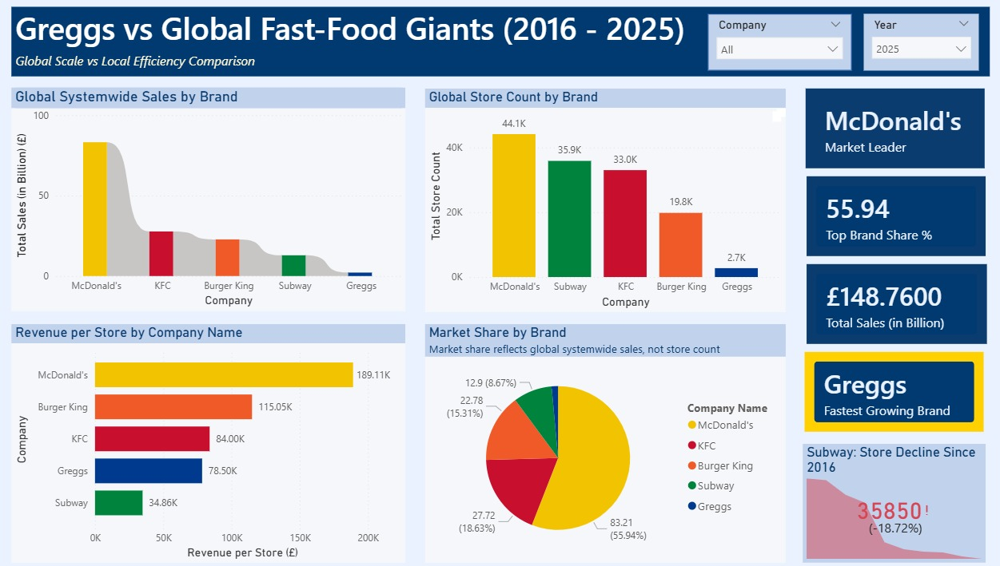
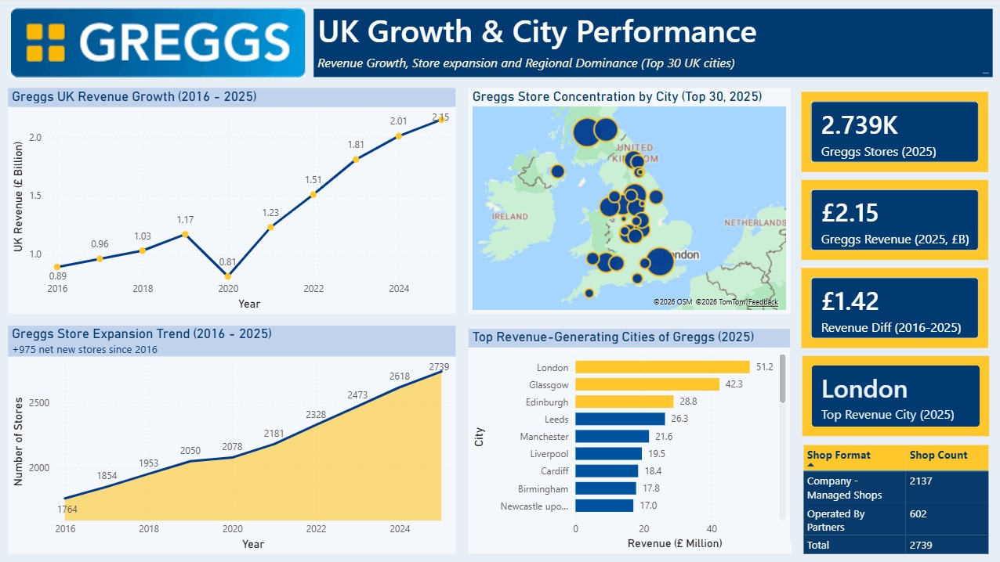
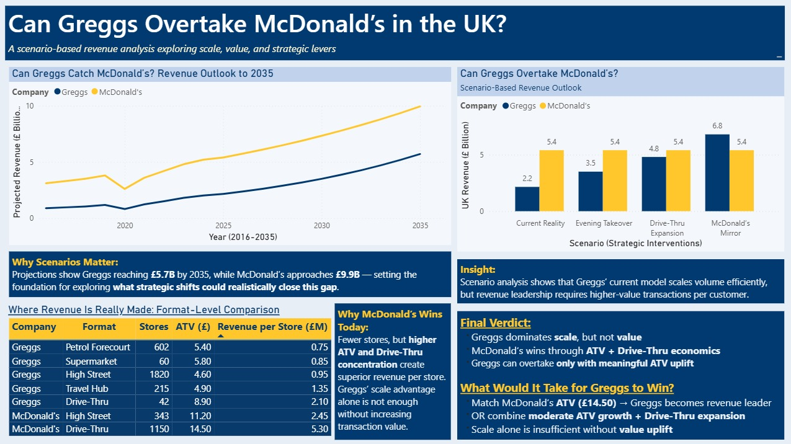

# UK Fast-Food Market Intelligence & Strategic Growth Analysis

**Power BI | Business Intelligence | Competitive Benchmarking | Scenario Analysis**

## Project overview

This portfolio case study investigates how **Greggs** compares with **McDonald's, KFC, Burger King and Subway**. Four Power BI report pages explore differences in market scale, revenue trends, store networks, location-level efficiency and potential growth strategies.

The central business question is: **Can Greggs narrow the revenue gap with McDonald's, and which business-model changes might matter most?**

> **Interpretation note:** Values in the dashboards reflect the dataset and assumptions used to construct the report. Historical figures, cross-brand comparisons and hypothetical future scenarios must not be interpreted as independently verified company disclosures. See [Data sources and assumptions](documentation/data_sources.md) before citing numbers externally.

## Business questions

1. How do the brands compare on reported or estimated sales/revenue and store footprints?
2. How has Greggs' UK revenue and store network changed between 2016 and 2025?
3. What does revenue per location suggest about differing operating models?
4. How might changes in average transaction value (ATV) and store format affect Greggs' relative position under *illustrative* scenarios?

## Dashboard gallery

### Page 1 — Global comparison

A global view of systemwide sales, store network scale, share of the *brands compared in the dataset*, and revenue-efficiency indicators. Market-share values here should not be mistaken for shares of the entire global restaurant market.

### Page 2 — Greggs UK growth and city analysis

Examines historical UK revenue, changes in store footprint, city-level estimates and geographical concentration. City-level revenue numbers require separate source and calculation validation before being represented as actual company-reported results.

### Page 3 — UK fast-food market comparison

Compares UK revenue trajectories, estimated outlet networks, transaction values and per-store performance. Revenue definitions and the treatment of franchised locations can differ by brand.

### Page 4 — Growth scenarios

Explores baseline projections and illustrative interventions, including transaction-value improvement and drive-thru expansion. **These are scenario exercises, not predictions or committed financial guidance.**

## Analytical approach

| Stage | Portfolio work |
|---|---|
| Market framing | Defined peer brands and key competitive questions |
| Benchmarking | Compared revenue/sales, store footprint, ATV and derived ratios |
| Trend exploration | Visualised historical Greggs growth and peer revenue trajectories |
| Geographic analysis | Reviewed store concentration and illustrative city-level revenue patterns |
| Scenario analysis | Compared potential strategic interventions with a baseline model |
| Communication | Presented findings through four executive-style Power BI pages |

**Tool evidenced by this portfolio:** Power BI. Specific Power Query transformations, DAX measures and other tools should only be added here once verified in the `.pbix` file.

## Main insights from the dashboard

- **Network scale is different from revenue efficiency:** A larger number of shops does not automatically imply higher revenue per location.
- **ATV matters:** The report explores how differences in transaction value may contribute to the revenue gap between Greggs and McDonald's.
- **Format matters:** Drive-thru and other higher-throughput/higher-value store formats are evaluated as possible strategic levers.
- **Scenarios make assumptions visible:** Comparing alternative growth paths is more useful than treating one projection as inevitable.

## Files

- [`images/`](images/) — four dashboard-page screenshots.
- [`dashboard/`](dashboard/) — Power BI report (`.pbix`), where available.
- [`documentation/data_sources.md`](documentation/data_sources.md) — source-provenance checklist, metric definitions, scenario assumptions and comparability cautions.

## Limitations and responsible use

- The comparison combines businesses with different ownership, franchise and reporting structures. **Systemwide sales are not necessarily equivalent to recognised company revenue.**
- Currency conversions, UK/global scope, reporting periods and store-count definitions need consistent documentation.
- Historical chart figures and city-level values have **not yet been independently revalidated against primary data sources** in this repository.
- No causal effect or future financial outcome can be established from scenario comparisons alone.

## Portfolio context

A business analytics and dashboard case study. Any jointly developed material should be credited to its actual contributors; project ownership and roles must be confirmed before using the work as evidence of independent experience.
